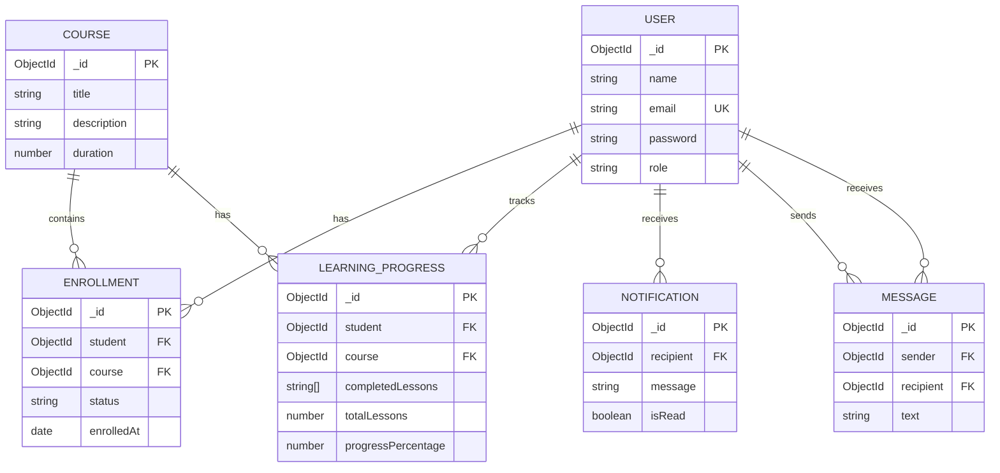

# LearnSphere — Database Schema (Task 11)

## Scope

Task 11 defines the MongoDB/Mongoose document schemas, references, constraints,
indexes and conceptual relationship diagram. It does **not** connect the running
Express application to MongoDB or migrate the existing JSON data. Database
connection and database-backed CRUD are Task 12.

MongoDB database (local example): `faceprep_course_system`.

Configure `MONGO_URI` in `backend/.env`. For MongoDB Atlas, keep the Atlas URI
instead of the local example. Never commit real database credentials.

## Collections and fields

### 1. `users` — `backend/models/User.js`

| Field | Type | Required | Constraints / purpose |
|---|---|---:|---|
| `_id` | ObjectId | auto | MongoDB document identifier |
| `name` | String | Yes | Trimmed, maximum 100 characters |
| `email` | String | Yes | Trimmed, lowercase, unique, maximum 254 characters |
| `password` | String | Yes | `select: false`; store a password hash, never plaintext |
| `role` | String | Yes | `student` or `admin`; defaults to `student` |
| `createdAt`, `updatedAt` | Date | auto | Mongoose timestamps |

Unique index: `{ email: 1 }`.

### 2. `courses` — `backend/models/Course.js`

| Field | Type | Required | Constraints / purpose |
|---|---|---:|---|
| `_id` | ObjectId | auto | MongoDB document identifier |
| `title` | String | Yes | Trimmed, maximum 150 characters |
| `description` | String | Yes | Trimmed, maximum 2000 characters |
| `duration` | Number | Yes | Minimum 1; duration unit must be defined by the application |
| `createdAt`, `updatedAt` | Date | auto | Mongoose timestamps |

### 3. `enrollments` — `backend/models/Enrollment.js`

| Field | Type | Required | Constraints / purpose |
|---|---|---:|---|
| `_id` | ObjectId | auto | MongoDB document identifier |
| `student` | ObjectId → `users` | Yes | Reference to the enrolled student |
| `course` | ObjectId → `courses` | Yes | Reference to the selected course |
| `status` | String | Yes | `active`, `completed`, or `withdrawn`; defaults to `active` |
| `enrolledAt` | Date | No | Defaults to current date/time |
| `createdAt`, `updatedAt` | Date | auto | Mongoose timestamps |

Unique compound index: `{ student: 1, course: 1 }`. This prevents duplicate
records for the same student/course pair. To support re-enrollment, update an
existing `withdrawn` record back to `active`; do not insert a second record.

### 4. `learningprogress` — `backend/models/LearningProgress.js`

| Field | Type | Required | Constraints / purpose |
|---|---|---:|---|
| `_id` | ObjectId | auto | MongoDB document identifier |
| `student` | ObjectId → `users` | Yes | Learner reference |
| `course` | ObjectId → `courses` | Yes | Course reference |
| `completedLessons` | Array of String | No | Completed lesson identifiers; defaults to `[]` |
| `totalLessons` | Number | Yes | Minimum 0; defaults to 0 |
| `progressPercentage` | Number | No | Range 0–100; defaults to 0 |
| `createdAt`, `updatedAt` | Date | auto | Mongoose timestamps |

Unique compound index: `{ student: 1, course: 1 }`.

### 5. `notifications` — `backend/models/Notification.js`

| Field | Type | Required | Constraints / purpose |
|---|---|---:|---|
| `_id` | ObjectId | auto | MongoDB document identifier |
| `recipient` | ObjectId → `users` | Yes | User who receives the notification |
| `message` | String | Yes | Trimmed, maximum 500 characters |
| `isRead` | Boolean | No | Defaults to `false` |
| `createdAt`, `updatedAt` | Date | auto | Mongoose timestamps |

Query index: `{ recipient: 1, createdAt: -1 }`.

### 6. `messages` — `backend/models/Message.js`

| Field | Type | Required | Constraints / purpose |
|---|---|---:|---|
| `_id` | ObjectId | auto | MongoDB document identifier |
| `sender` | ObjectId → `users` | Yes | User who sent the message |
| `recipient` | ObjectId → `users` | Yes | User who receives the message |
| `text` | String | Yes | Trimmed, maximum 2000 characters |
| `createdAt`, `updatedAt` | Date | auto | Mongoose timestamps |

Conversation query index: `{ sender: 1, recipient: 1, createdAt: -1 }`.

## Relationship diagram



## Important design notes

- MongoDB creates an `_id` ObjectId for every document automatically.
- Mongoose `ref` fields define logical references; MongoDB does not enforce SQL-style foreign keys.
- Enrollment and learning progress each have a unique student/course pair.
- User email is unique. Do not add a second duplicate email index.
- Notification and message indexes support common recipient/conversation lookups.
- `timestamps: true` adds `createdAt` and `updatedAt` to every schema.
- The existing Task 10 JSON-backed app remains unchanged in this task. Task 12 will connect Mongoose and migrate relevant services/controllers to database operations.

## Validation check

From the `backend` directory, run:

```bash
npm install
npm run test:schemas
```

This validates required fields and key unique indexes without requiring a running
MongoDB server. It does not create collections or insert documents.

## Task 12 integration status

The Express backend now connects through `backend/config/db.js` using `MONGO_URI`.
Student registration/login and course CRUD use the `User` and `Course` Mongoose
models. The two starter course records are inserted only when the MongoDB
`courses` collection is empty. The health endpoint reports the MongoDB connection
state. The `Enrollment`, `LearningProgress`, `Notification`, and `Message` models
remain schema-ready for their feature workflows in later tasks.
